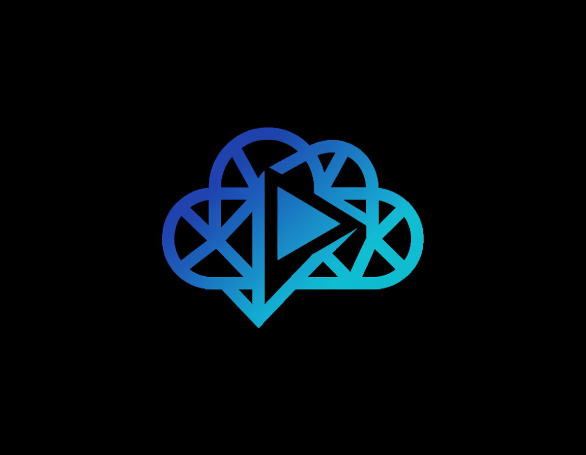

<p align="center">
  
</p>

<h1 align="center">OmniStream</h1>

<p align="center">
  <strong>Stream from anywhere. One platform, every cloud.</strong>
</p>

<p align="center">
  <a href="#features"></a>
  <a href="#tech-stack"></a>
  <a href="#pwa"></a>
  <a href="#license"></a>
</p>

<p align="center">
  <a href="#getting-started">Getting Started</a> •
  <a href="#features">Features</a> •
  <a href="#tech-stack">Tech Stack</a> •
  <a href="#screenshots">Screenshots</a> •
  <a href="#contributing">Contributing</a>
</p>

---

## 🎯 About

**OmniStream** is a modern, multi-cloud video streaming platform that lets you stream and download files from multiple cloud storage providers — all in one place. No more switching between apps.

Currently supported sources:
- ☁️ **Google Drive** — Browse & stream directly from your Drive
- 📦 **TeraBox** — Stream & download in HD quality  
- 💾 **OneDrive** — Coming soon
- 📂 **Dropbox** — Coming soon

---

## ✨ Features

### 🌐 Multi-Cloud Integration
| Feature | Description |
|---------|-------------|
| **Google Drive** | OAuth integration, browse folders, stream videos |
| **TeraBox** | Paste links, instant streaming, multi-quality |
| **Unified Library** | All your cloud files in one dashboard |

### 🎥 Advanced Video Player
- **HLS Streaming** with adaptive quality (360p → 4K)
- **Picture-in-Picture** mode
- **Theater Mode** & fullscreen
- **Speed Controls** (0.25x - 2x)
- **Keyboard Shortcuts** for power users
- **Subtitle Support**

### 📱 Progressive Web App
- Install as a native app on any device
- **Share Target** — share links directly to OmniStream
- Mobile-optimized bottom navigation
- Offline-capable with service worker caching

### 🛠️ Platform Features
- 📊 **Dashboard** — Activity stats, recent streams, usage overview
- ⭐ **Favorites** — Save your top videos
- 📁 **Collections** — Organize videos into playlists
- 📥 **Download History** — Track all your downloads
- 🔗 **Shared Links** — Generate short links to share
- 🎨 **Themes** — Dark / Light / System auto-switch
- ⌨️ **Command Palette** (`Ctrl+K`) — Quick navigation
- 🔔 **Notification Center** — Stay updated  
- 🛡️ **Admin Panel** — User management & analytics

### 🔌 Browser Extension
- Auto-detect cloud storage links
- One-click stream or download
- Right-click context menu integration
- Keyboard shortcuts (`Alt+T`)

---

## 🚀 Getting Started

### Prerequisites
- **Node.js** 18+ 
- **npm** 9+ or **yarn**

### Installation

```bash
# Clone the repository
git clone https://github.com/ashrafulislamse/omnistream.git

# Navigate to project directory
cd omnistream

# Install dependencies
npm install

# Set up environment variables
cp .env.example .env
# Edit .env with your credentials
```

### Development

```bash
npm run dev
```

The app will be available at `http://localhost:8080`

### Build for Production

```bash
npm run build
npm run preview  # Preview the build
```

---

## 🏗️ Tech Stack

<table>
<tr>
<td align="center"><strong>Layer</strong></td>
<td align="center"><strong>Technology</strong></td>
</tr>
<tr>
<td>🖥️ Frontend</td>
<td>React 18, TypeScript 5, Vite 5</td>
</tr>
<tr>
<td>🎨 Styling</td>
<td>Tailwind CSS, shadcn/ui</td>
</tr>
<tr>
<td>🎭 Icons</td>
<td>Lucide React</td>
</tr>
<tr>
<td>🔐 Auth</td>
<td>Appwrite Auth (OAuth + Email)</td>
</tr>
<tr>
<td>🗄️ Database</td>
<td>Appwrite Database</td>
</tr>
<tr>
<td>⚡ Functions</td>
<td>Appwrite Cloud Functions</td>
</tr>
<tr>
<td>🚀 Cache</td>
<td>Upstash Redis (REST)</td>
</tr>
<tr>
<td>📱 PWA</td>
<td>vite-plugin-pwa, Workbox</td>
</tr>
<tr>
<td>🎬 Player</td>
<td>HLS.js</td>
</tr>
</table>

---

## 📁 Project Structure

```
omnistream/
├── public/                  # Static assets & PWA icons
├── src/
│   ├── components/          # Reusable UI components
│   │   ├── layout/          # AppShell, Sidebar, CommandPalette
│   │   └── ui/              # Buttons, Cards, Modals (shadcn)
│   ├── contexts/            # Auth, Theme providers
│   ├── hooks/               # Custom hooks (useTeraBox, useGoogleDrive, etc.)
│   ├── lib/                 # Utilities & Appwrite client
│   ├── pages/               # Route pages
│   │   ├── Landing.tsx      # Marketing landing page
│   │   ├── Dashboard.tsx    # User dashboard
│   │   ├── Stream.tsx       # TeraBox streaming
│   │   ├── Drive.tsx        # Google Drive browser
│   │   ├── Sources.tsx      # Cloud sources manager
│   │   └── ...              # Auth, Settings, Admin, etc.
│   ├── services/            # API services
│   ├── types/               # TypeScript type definitions
│   └── integrations/        # Backend integrations
├── extension-starter/       # Chrome/Edge browser extension
│   ├── popup/               # Extension popup UI
│   ├── options/             # Extension settings page
│   └── content/             # Content scripts
└── supabase/                # Legacy Supabase edge functions
    └── functions/           # Serverless API handlers
```

---

## 🔧 Environment Variables

```env
# App
VITE_APPWRITE_ENDPOINT=https://cloud.appwrite.io/v1
VITE_APPWRITE_PROJECT_ID=your_project_id

# Google OAuth
VITE_GOOGLE_CLIENT_ID=your_google_client_id

# Redis (for backend functions)
UPSTASH_REDIS_REST_URL=your_redis_url
UPSTASH_REDIS_REST_TOKEN=your_redis_token
```

---

## 🤝 Contributing

Contributions are welcome! Please follow these steps:

1. **Fork** the repository
2. **Create** a feature branch: `git checkout -b feature/amazing-feature`
3. **Commit** your changes: `git commit -m 'Add amazing feature'`
4. **Push** to the branch: `git push origin feature/amazing-feature`
5. **Open** a Pull Request

### Development Guidelines
- Follow the existing code style and patterns
- Write meaningful commit messages
- Test your changes thoroughly
- Update documentation when needed

---

## 📄 License

This project is licensed under the **MIT License** — see the [LICENSE](LICENSE) file for details.

---

## 👨‍💻 Developer

<p align="center">
  <strong>Md Ashraful Islam</strong><br/>
  <a href="https://github.com/ashrafulislamse">@ashrafulislamse</a>
</p>

---

<p align="center">
  <sub>Built with ❤️ by <a href="https://github.com/ashrafulislamse">Md Ashraful Islam</a></sub><br/>
  <sub>© 2025 OmniStream. All rights reserved.</sub>
</p>
