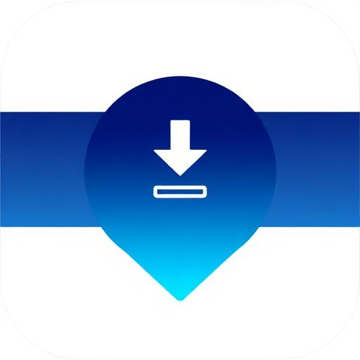

# OmniStream Browser Extension 2.0

<div align="center">
  
  <h3>Stream, Download & Save TeraBox Content Instantly</h3>
  <p>Skip ads. Get direct links. Manage your files.</p>
</div>

---

## Design System v2.0

The extension UI is built on a unified design system matching the OmniStream web app:

- **Fonts** — Inter (body), Space Grotesk (headings), JetBrains Mono (code/stats)
- **Colors** — Dark navy HSL palette (`222 25% 7%` base) with teal/cyan gradient accents (`173 80% 48%` → `191 91% 43%`)
- **Radius** — 6px / 10px / 14px / 16px / 9999px (pill)
- **Motion** — `cubic-bezier(.16,1,.3,1)` spring easing, 150–300ms durations
- **Components** — Glassmorphism cards, gradient buttons, color-coded file badges, Lucide SVG icons throughout

---

## Features

### TeraBox Page Enhancement
When you visit a TeraBox link, OmniStream automatically:
- Shows file info with color-coded type badges (video/audio/image/archive)
- Provides one-click streaming and download with SVG icon buttons
- Displays cached status with gradient badge
- Draggable overlay with minimize/expand states
- Thumbnail preview or icon placeholder for featured files

### Smart Link Detection
- Detects TeraBox links on **any webpage**
- Shows inline teal badge next to detected links
- **Rich preview card on hover** with file info, TERABOX badge, and URL
- Three quick actions: Save, Stream, Copy link
- Animated card entrance with spring easing

### Premium Popup UI
- **Dashboard tab** — Current page detection, quick add URL, file preview card, quick actions grid (Stream, Download, Save, Copy)
- **Library tab** — Search input with filter chips (All/Video/Audio/Archive), file cards with type icons
- **Activity tab** — Persistent timeline of recent actions with timestamps
- **Stats tab** — 2x2 stat cards with bar chart fills, account card with avatar initials
- Gradient CTA footer, skeleton loading states, toast notifications

### Keyboard Shortcuts
| Shortcut | Action |
|----------|--------|
| `Alt + T` | Open OmniStream popup |
| `Alt + S` | Save current page link |
| `Alt + D` | Quick download current file |

### Context Menu
Right-click on any TeraBox link to:
- **Save to Favorites**
- **Stream Now**
- **Download**
- **Copy Direct Link**

### Settings Page
- Theme selector (Dark/Light/System)
- Notification and sound toggles with animated switch
- Overlay visibility and clipboard detection toggles
- Appwrite backend configuration with connection test
- Account management with avatar initials
- Keyboard shortcut reference with `kbd` styled keys
- About section with version badge and external links

---

## Installation

### Chrome / Edge / Brave

1. **Download** the extension folder
2. Open `chrome://extensions/` (or `edge://extensions/`)
3. Enable **Developer mode** (toggle in top-right)
4. Click **Load unpacked**
5. Select the `extension-starter` folder
6. Pin the extension to your toolbar

### Firefox (Coming Soon)
Firefox version is under development.

---

## Project Structure

```
extension-starter/
├── manifest.json              # Extension manifest (MV3)
├── background/
│   └── service-worker.js      # API calls, auth, notifications, context menus
├── content/
│   ├── terabox-enhancer.js    # Floating overlay on TeraBox pages (SVG icons)
│   ├── overlay.css            # Overlay styles (Design System v2.0)
│   ├── link-detector.js       # Link detection + preview cards on all pages
│   └── token-bridge.js        # Auth token sync with web app
├── popup/
│   ├── popup.html             # 4-tab layout with dashboard/library/activity/stats
│   ├── popup.css              # Full design system: glassmorphism, gradients, badges
│   └── popup.js               # Tab switching, search/filter, activity log, SVG icons
├── options/
│   ├── options.html           # Card-based settings with Lucide SVG logo
│   ├── options.css            # Inter/Space Grotesk fonts, HSL tokens, toggles
│   └── options.js             # Settings persistence, auth avatar, connection test
├── assets/
│   └── icons/                 # Extension icons (16/32/48/128px)
└── README.md
```

---

## Permissions Explained

| Permission | Why Needed |
|------------|------------|
| `storage` | Save settings, cached data, and recent links |
| `notifications` | Show alerts when files are ready |
| `contextMenus` | Add right-click options on links |
| `activeTab` | Access current tab to detect TeraBox pages |
| `scripting` | Inject content scripts on TeraBox pages |
| `clipboardRead` | Detect TeraBox links in clipboard |
| `alarms` | Schedule periodic cache cleanup |

---

## Privacy

- **No data collection** — We don't collect any personal data
- **Local storage** — All settings stored locally in `chrome.storage`
- **Secure API calls** — Communication with OmniStream uses HTTPS
- **Open source** — Review the code yourself

---

## Integration with OmniStream App

This extension integrates seamlessly with your OmniStream deployment:

1. **Visit your OmniStream web app** — config is auto-synced via token-bridge
2. **Sign in** once in the web app
3. **Token is shared** with the extension automatically
4. **Sync favorites** across devices
5. **Track downloads** in your dashboard

### First-Time Setup (Appwrite Backend)

If the extension isn't auto-configured, open **Extension Settings** and enter:

| Field | Description |
|-------|-------------|
| **Appwrite Endpoint** | e.g. `https://cloud.appwrite.io/v1` |
| **Project ID** | Your Appwrite project ID |
| **Cloud Service Function ID** | The `cloud-service` function ID |
| **Platform API Function ID** | The `platform-api` function ID |
| **App URL** | Your deployed OmniStream URL |

These values are in your `.env` file (`VITE_APPWRITE_*` variables).

---

## Development

### Prerequisites
- Chrome/Edge/Brave browser
- Node.js 18+ (optional, for icon generation)

### Setup
```bash
git clone https://github.com/AshrafulIslam-SE/OmniStream.git
cd OmniStream/extension-starter

# Load in browser (see Installation section)
```

### Making Changes
1. Edit files in the `extension-starter` folder
2. Go to `chrome://extensions/`
3. Click the refresh icon on the OmniStream extension
4. Test your changes

### Building for Production
No build step required. The extension runs as-is with vanilla HTML/CSS/JS.

### Deployment Configuration

All environment-specific config is centralized. To switch between local dev and production:

| What to change | File | Line |
|---|---|---|
| **App URL** (the only required change) | `background/service-worker.js` | `DEFAULT_APP_URL` at line 8 |
| **Token-bridge domains** (if custom domain) | `manifest.json` | `content_scripts[1].matches` array |
| **Host permissions** (if custom domain) | `manifest.json` | `host_permissions` array |

**For local development:**
```js
const DEFAULT_APP_URL = 'http://localhost:5173';
```

**For production (Appwrite):**
```js
const DEFAULT_APP_URL = 'https://omnistream.appwrite.network';
```

> The Appwrite endpoint, project ID, and function IDs are configured at runtime via the **Settings** page — they don't need to be changed in code. Users can also override the App URL in Settings.

---

## Troubleshooting

### Extension not loading?
- Check for errors in `chrome://extensions/`
- Ensure all files are present (especially icons)
- Make sure manifest.json is valid JSON

### Overlay not showing?
- Check if you're on a TeraBox share page (URL contains `/s/`)
- Make sure "Show overlay" is enabled in settings
- Try refreshing the page

### Not authenticated?
- Visit the OmniStream web app and sign in
- The extension will sync your authentication via token-bridge

### API errors?
- Check your internet connection
- Verify Appwrite config in Settings → Test Connection
- The TeraBox API might be rate-limited — try again in a few minutes

---

## Changelog

### v2.0.0 (Current)
- **Design System v2.0** — Inter/Space Grotesk/JetBrains Mono, HSL tokens, glassmorphism
- **Popup redesign** — 4-tab dashboard with activity timeline, search/filter, stat charts
- **Overlay redesign** — SVG Lucide icons, gradient logo, color-coded badges, progress bar
- **Link detector** — Rich hover preview cards with Save/Stream/Copy actions
- **Options redesign** — Card-based layout, animated toggles, auth avatars, connection test
- **Context menus** — Clean titles, all TeraBox domains supported
- **Token bridge** — Auto-sync auth from web app, Appwrite cookie fallback

### v1.0.0
- Initial release
- Basic link saving functionality

---

## License

MIT License — See [LICENSE](../LICENSE) for details

---

<div align="center">
  <p>Made with care by Md Ashraful Islam</p>
  <a href="https://github.com/AshrafulIslam-SE/OmniStream">GitHub</a>
</div>
